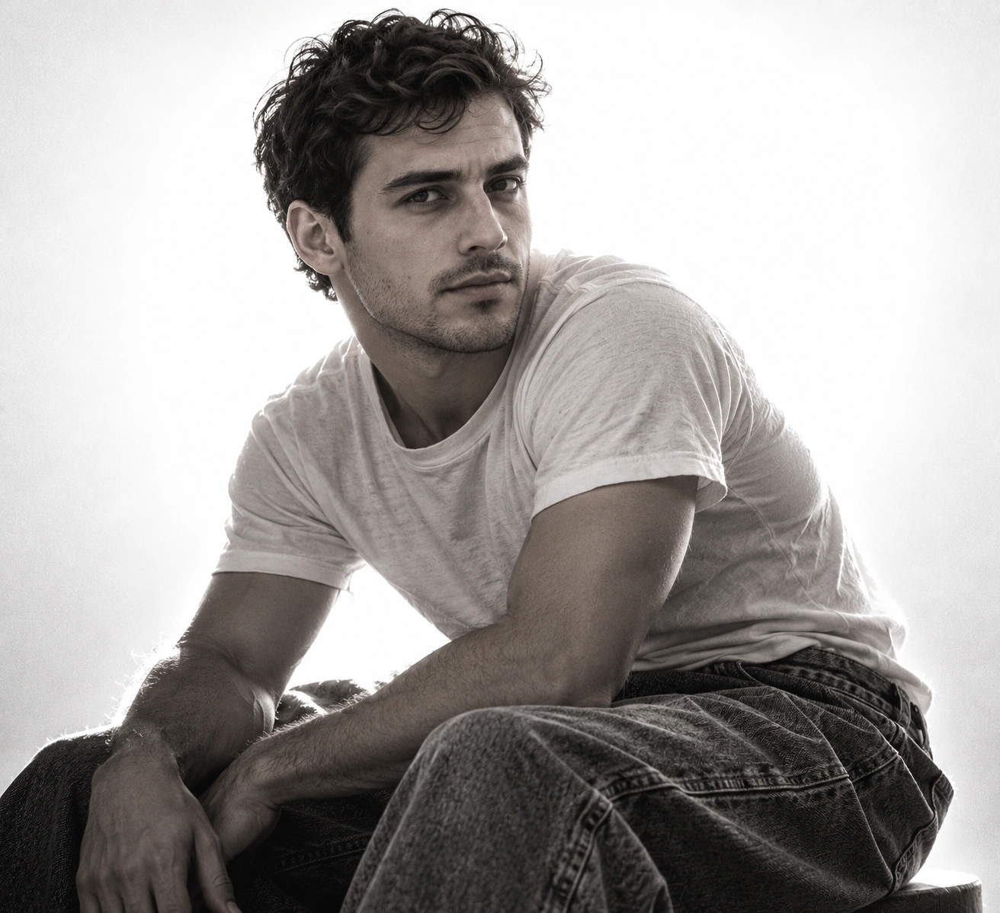

## Пост

Минималистичный монохромный студийный портрет: человек сидит полубоком в светлой футболке и мешковатых джинсах, смотрит в камеру, а сильный контровой свет создаёт яркую кайму на почти белом фоне.

## Назначение

Превращение загруженного портрета в напряжённую фэшн-съёмку на стыке гранжа и минимализма с выразительным контрастом и фактурой ткани.

## Инструкция

1. Загрузить чёткое фото человека для сохранения внешности.
2. Применить полный исходный промпт.
3. Проверить сходство, естественность позы и рук, полутень на лице, контровую кайму и почти пересвеченный белый фон.
4. Соотношение сторон исходным промптом не задано.

## Промпт

```text
Сохранить внешность на 100%. Не изменять черты лица, пропорции. Студийный чёрно-белый фэшн-портрет: человек сидит полубоком, смотрит прямо в камеру. Спина и пресс напряжены, корпус изогнут. На нём светлая футболка и свободные мешковатые джинсы. Сочетание гранжа и минимализма. Средний план, чёткий фокус на модели. За спиной мощный источник света создаёт почти пересвеченный белый фон и яркую световую кайму вдоль силуэта. Контровой свет выделяет плечи и контуры одежды, лицо и волосы остаются в полутени, черты узнаваемы. Глубокие тени, выразительный контраст, высокая детализация ткани, деликатное плёночное зерно. Атмосфера напряжённая, загадочная, с грубоватой эстетикой художественной глянцевой съёмки.
```

## Примечания

- Исходный русский промпт сохранён полностью без изменений; отдельный перевод не требуется.
- Требование «Сохранить внешность на 100%» является пожеланием исходника, а не гарантией генератора. Сходство следует проверять.
- В присланном посте упомянуты @creatory и @aicreator; автор и конкретная публикация не установлены.
- Социальная обвязка удалена. Хештег nanobanana не создаёт технической привязки к платформе.
- Связанная карточка описывает другой high-key портрет: костюм или тренч, поза стоя и butterfly lighting. Настоящий промпт отличается сидячей позой, футболкой, джинсами и контровым светом.

## Образец S01



Семпл создан встроенным imagegen по исходному промпту с ранее созданным демонстрационным портретом вымышленного взрослого мужчины. Это не фото пользователя. Визуально проверены сидячая поза полубоком, взгляд в камеру, светлая футболка, мешковатые джинсы, яркий фон и контровая кайма. Статус pending — до оценки пользователем.

[Демонстрационный референс R01](../../../03_SAMPLES/AR-20261005-011/R01.webp)
