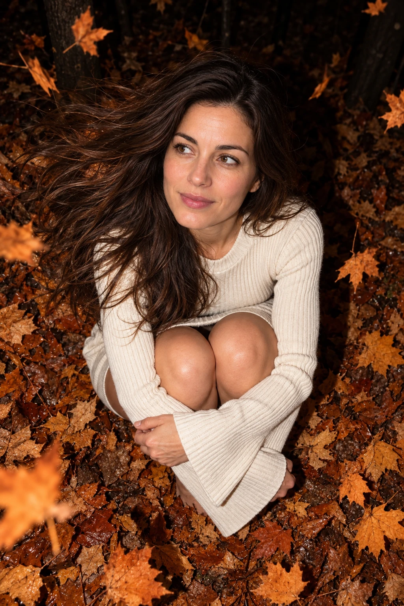

## Пост
Реалистичный осенний портрет по исходному фото: человек сидит среди кленовых листьев в ночном лесу, камера направлена сверху, передний план освещён прямой вспышкой.

## Назначение
Создать вертикальный портрет в осеннем окружении с сохранением внешности человека из референса.

## Инструкция
1. Выбрать портретное фото хорошего качества с хорошо различимым лицом.
2. Приложить фото и полный исходный промпт одним сообщением в сервисе, поддерживающем работу с референсом.
3. Проверить сходство лица, положение рук и коленей, одежду, ракурс и освещение.
4. В исходном посте рекомендован PixelNanoBot; технической зависимости от этого бота у текста промпта нет.

## Промпт — оригинал
```text
Сохранить внешность на 100%. Не менять черты лица, пропорции. Реалистичный осенний портрет человека в центре кадра в ночном лесу. Камера сверху, вертикальный крупный кадр. Сидит на корточках среди ковра сухих оранжево-коричневых кленовых листьев, подтянув ноги к груди. Обнимает колени обеими руками. Взгляд устремлён вбок. Молочное трикотажное мини-платье-лонгслив в рубчик с длинными расклёшенными рукавами. Распущенные волосы сильно развеваются в сторону от ветра. Летят сухие оранжевые листья. Фон — тёмный лес, едва различимые стволы и земля в листьях. Яркая жесткая вспышка освещает лицо, белый трикотаж и листья на переднем плане на почти чёрном фоне. Тёплая оранжево-медная осенняя палитра. Стиль lifestyle-блога. direct flash, top-down angle, warm orange leaves, high detail, 8k.
```

## Промпт — перевод на русский
```text
Сохранить внешность на 100%. Не менять черты лица, пропорции. Реалистичный осенний портрет человека в центре кадра в ночном лесу. Камера сверху, вертикальный крупный кадр. Сидит на корточках среди ковра сухих оранжево-коричневых кленовых листьев, подтянув ноги к груди. Обнимает колени обеими руками. Взгляд устремлён вбок. Молочное трикотажное мини-платье-лонгслив в рубчик с длинными расклёшенными рукавами. Распущенные волосы сильно развеваются в сторону от ветра. Летят сухие оранжевые листья. Фон — тёмный лес, едва различимые стволы и земля в листьях. Яркая жесткая вспышка освещает лицо, белый трикотаж и листья на переднем плане на почти чёрном фоне. Тёплая оранжево-медная осенняя палитра. Стиль блога о повседневной жизни. Прямая вспышка, ракурс сверху вниз, тёплые оранжевые листья, высокая детализация, 8k.
```

## Семпл
Демонстрация создана с помощью imagegen по исходному промпту без изменения текста. Референс — синтетический портрет вымышленной взрослой женщины, созданный специально для этой проверки; это не фотография пользователя.




### Создание демонстрационного исходника
```text
Create a realistic neutral reference portrait photograph of a fictional adult woman age 30, chest up, long loose dark brown hair, brown eyes, natural facial features and skin texture, plain gray crewneck shirt, soft even daylight, plain light gray backdrop, looking into camera. Vertical portrait. This is a synthetic demonstration input for testing an identity-preserving autumn photo prompt, not a real user's photograph. No text or watermarks.
```

Это служебное описание генерации референса; исходный рабочий промпт сохранён выше отдельно.

### Проверка семпла
Вертикальный кадр, верхний ракурс, поза с обнятыми коленями, молочный трикотаж, развевающиеся волосы, летящие листья и тёмный лес присутствуют. Лицо узнаваемо относительно демонстрационного референса. Проверка визуальная; количественная оценка сходства не выполнялась. Семпл ожидает оценки пользователя.

## Примечания
- Исходный промпт сохранён полностью и буквально. Полный русский перевод добавлен рядом из-за английского окончания.
- Заявление «Сохранить внешность на 100%» — требование исходного промпта, а не гарантия результата.
- Числовое соотношение сторон не задано: требуется вертикальный кадр. «8k» сохранено как часть исходного текста и не означает подтверждённое разрешение семпла.
- Ссылка взята из предоставленного поста и ведёт на рекомендованный бот; автор промпта и адрес публикации не указаны.
- Декоративные эмодзи и рекламная обвязка исключены.
