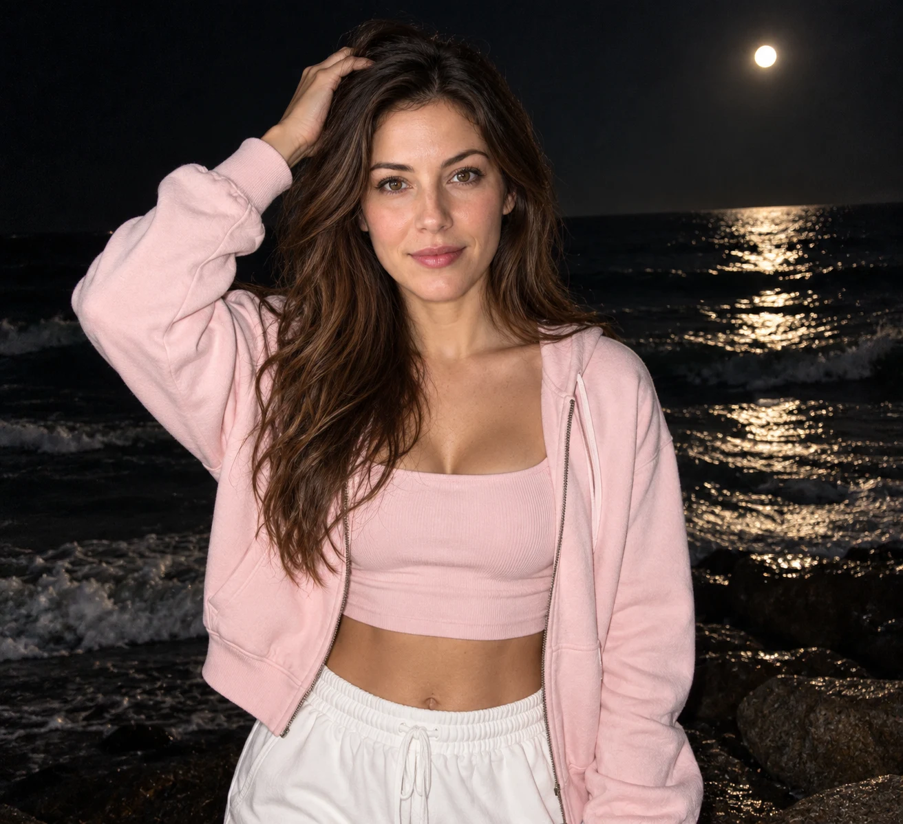

## Пост
Ночной портрет на берегу моря: полная луна, лунная дорожка, светло-розовая одежда и жёсткая фронтальная вспышка.

## Назначение
Создать атмосферный морской портрет по референсному фото с сохранением узнаваемой внешности.

## Инструкция
1. Загрузить чёткое фото взрослого человека с хорошо различимым лицом.
2. Передать фото вместе с исходным промптом в модель с поддержкой изображений-референсов.
3. Проверить сходство лица, положение рук, одежду, лунную дорожку, резкость фона и фронтальную вспышку.

## Промпт — оригинал
```text
Внешность сохранить на 100%. Не изменять черты лица, пропорции. Canon G7X Mark III со вспышкой: девушка стоит ночью на берегу моря, полная луна. У нее спокойный взгляд в камеру. Одна рука поправляет волосы на макушке, вторая свободно опущена. Чистая сияющая кожа, легкий идеальный макияж, длинные ресницы. Ракурс прямой. Дорогая качественная плотная одежда: светло-розовые худи на молнии и укороченный топ, белые свободные спортивные брюки, распущенные волосы. Тёмное море с лунной дорожкой и волнами, резкий фон. Жёсткая фронтальная вспышка, натуральная кожа, лёгкое зерно, RAW Pinterest night aesthetic.
```

## Промпт — перевод на русский
```text
Внешность сохранить на 100%. Не изменять черты лица, пропорции. Canon G7X Mark III со вспышкой: девушка стоит ночью на берегу моря, полная луна. У нее спокойный взгляд в камеру. Одна рука поправляет волосы на макушке, вторая свободно опущена. Чистая сияющая кожа, легкий идеальный макияж, длинные ресницы. Ракурс прямой. Дорогая качественная плотная одежда: светло-розовые худи на молнии и укороченный топ, белые свободные спортивные брюки, распущенные волосы. Тёмное море с лунной дорожкой и волнами, резкий фон. Жёсткая фронтальная вспышка, натуральная кожа, лёгкое зерно, Эстетика ночной фотографии Pinterest в стиле RAW.
```

## Примечания
- Исходный промпт сохранён буквально; из-за английского окончания добавлена полная русская версия.
- Требование «Внешность сохранить на 100%» не гарантирует точного совпадения лица.
- Canon G7X Mark III описывает визуальный характер снимка, а не техническую зависимость от платформы генерации.
- В исходном посте указан хэштег nanobanana; тестирование в этой модели не подтверждено. Текст универсален, поэтому поле platform не добавлено.
- Автор и ссылка на исходную публикацию не указаны. Упоминания @creatory и @aicreator являются социальной обвязкой, авторство из них не выводится.
- Соотношение сторон исходником не задано.

## Семпл
Демонстрационный исходник — вымышленная взрослая женщина, созданная imagegen; это не фотография пользователя. Исходный рабочий промпт применён буквально к этому референсу.




### Создание демонстрационного исходника
```text
Create a neutral reference photo for testing a portrait prompt: fictional adult woman age 28, long loose brown hair, natural facial features, light natural makeup, gray shirt, plain neutral background, straight-on chest-up portrait, even daylight, photorealistic. No text.
```

### Проверка
Море, полная луна и лунная дорожка присутствуют. Поза, розовые худи и топ, белые брюки и фронтальная вспышка соответствуют сценарию. Лицо визуально узнаваемо относительно демонстрационного исходника; количественная проверка сходства не проводилась. Нижняя часть брюк вне кадра. Семпл ожидает оценки пользователя.
