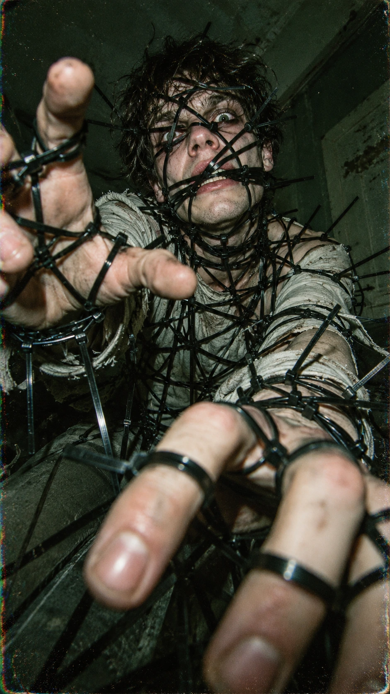

# Внутри сети — хоррор-портрет в паутине пластиковых стяжек

## Пост
Фотопортрет в атмосфере психологического триллера: пластиковые стяжки образуют хаотичную сеть вокруг человека, а широкоугольная перспектива, прямая вспышка и зеленоватый оттенок усиливают ощущение тесноты.

## Назначение
Создание вертикальной хоррор-фотографии в эстетике модной редакционной съёмки и винтажной компактной камеры.

## Инструкция
Передайте генератору изображений полный оригинальный промпт. Формат — вертикальный 9:16. Обязательных переменных и референса нет: исходник не содержит требования сохранить внешность конкретного человека. Демонстрационный персонаж вымышленный.

## Промпт — оригинал
```text
Person horror fashion editorial, extreme close-up, messy hair, intense unsettling expression, dozens of black plastic zip ties forming a chaotic web around his face, neck, arms, hands and torso, zip ties crossing directly over his eyes and mouth, hands reaching toward the camera with fingers tangled in zip ties, extreme wide-angle perspective, oversized foreground hands, claustrophobic composition, pale gray clothing, dark green-gray interior, harsh direct flash, sickly green color cast, deep shadows, gritty analog film grain, chromatic aberration, dirty vintage point-and-shoot aesthetic, surreal psychological horror, highly realistic skin pores, realistic hands, cinematic photography, raw imperfect texture, vertical 9:16.
```

## Промпт — перевод на русский
```text
Хоррор-фотосессия человека в стиле модного редакционного материала, экстремально крупный план, растрёпанные волосы, напряжённое тревожащее выражение лица, десятки чёрных пластиковых кабельных стяжек образуют хаотичную паутину вокруг его лица, шеи, рук, кистей и торса; стяжки проходят прямо поверх глаз и рта; руки тянутся к камере, пальцы запутаны в стяжках; экстремальная широкоугольная перспектива, огромные кисти на переднем плане, клаустрофобная композиция, бледно-серая одежда, тёмный зелёно-серый интерьер, жёсткая прямая вспышка, болезненный зеленоватый оттенок, глубокие тени, грубое зерно аналоговой плёнки, хроматическая аберрация, грязная эстетика винтажной компактной камеры, сюрреалистический психологический хоррор, высокореалистичные поры кожи, реалистичные руки, кинематографическая фотография, необработанная несовершенная фактура, вертикальный формат 9:16.
```

## Примечания
- Материал предоставлен пользователем. В исходном посте упомянуты @creatory и @aicreator; автор и ссылка на конкретную публикацию не указаны.
- Призывы перейти в каналы, декоративные эмодзи и общий хэштег исключены как социальная обвязка.
- Упоминание GPTimage25 в посте не является технической зависимостью; поле platform не добавлено.
- Оригинал сохранён полностью и буквально. Русский перевод не заменяет оригинал.
- Семпл создан по исходному промпту без демонстрационных подстановок. Статус pending означает, что оценка пользователя ещё не получена.

## Семпл

