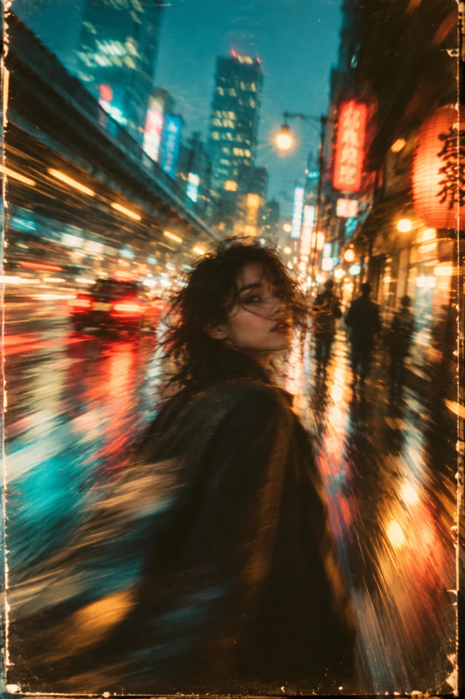

# Город в движении — неоновый портрет с размытием камеры

## Пост
Динамичный городской портрет: размытие движения камеры, неоновые световые следы, тёплые блики и бирюзовые тени создают мечтательную атмосферу аналоговой фотографии.

## Назначение
Создание художественного уличного портрета с эффектом движения камеры и ретроэстетикой в вертикальном формате 2:3.

## Инструкция
Передайте генератору изображений полный исходный промпт. Обязательных переменных нет. Для демонстрации используется вымышленный персонаж. Вводный пост предлагает преобразование фотографии, но сам оригинал не требует загруженного фото и не задаёт сохранение внешности. Если нужен конкретный человек, приложите его фото и отдельно укажите требование сохранить узнаваемость.

## Промпт — оригинал
```text
Dreamy cinematic photo of person in the street, strong motion blur and camera movement, soft focus edges, vibrant neon color grading, warm highlights and teal shadows, shallow depth of field, nostalgic analog film look, surreal atmosphere, artistic composition, light trails, creamy bokeh, retro aesthetic, emotional mood, photographed with vintage lens, experimental photography style, ultra detailed, aesthetic editorial vibe. Ratio 2:3
```

## Промпт — перевод на русский
```text
Мечтательная кинематографическая фотография человека на улице, сильное размытие движения и движение камеры, мягкая фокусировка по краям, насыщенная неоновая цветокоррекция, тёплые светлые участки и бирюзовые тени, малая глубина резкости, ностальгический вид аналоговой плёнки, сюрреалистическая атмосфера, художественная композиция, световые следы, мягкое кремовое боке, ретроэстетика, эмоциональное настроение, снято винтажным объективом, стиль экспериментальной фотографии, сверхвысокая детализация, эстетика редакционной съёмки. Соотношение сторон 2:3
```

## Примечания
- Материал предоставлен пользователем. В исходном посте упомянуты @creatory и @aicreator; автор и ссылка на конкретную публикацию не указаны.
- Призывы перейти в каналы, декоративные эмодзи и общий хэштег исключены как социальная обвязка.
- Упоминание GPTimage25 не является технической зависимостью; поле platform не добавлено.
- Оригинал сохранён полностью и буквально; перевод не заменяет исходник.
- Семпл создан по оригиналу без подстановок и без фото конкретного человека. Статус pending означает, что оценка пользователя ещё не получена.
- Эффект сильного размытия может уменьшать узнаваемость лица.

## Семпл

