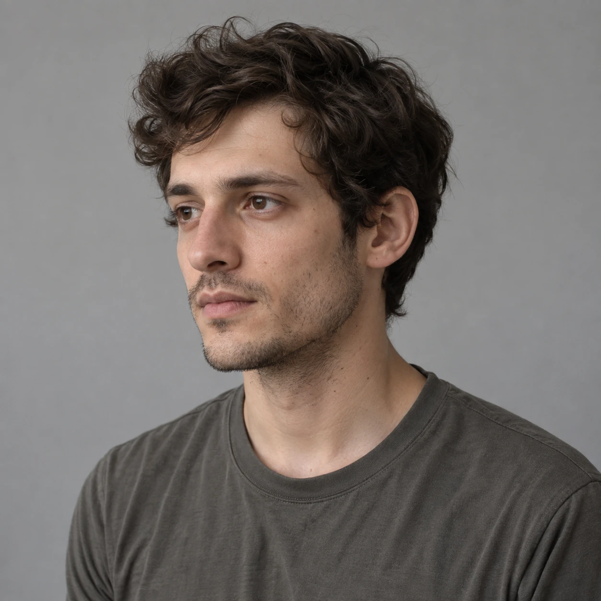
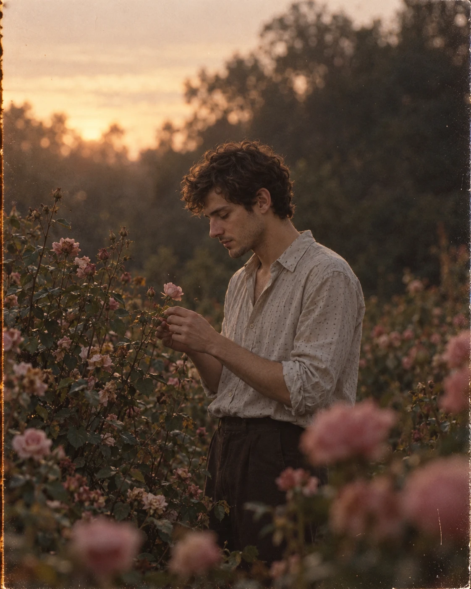

## Пост
Меланхоличный кинематографический портрет по фотографии: молодой человек бережно рассматривает одну небольшую розовую розу в заросшем саду. Приглушённые цвета, тёмное лицо в мягкой тени и плёночная эстетика артхаусного кино 1970–1990-х годов.

## Назначение
Создание атмосферного вертикального кадра 4:5 с сохранением внешности по референсу, наблюдательной дистанцией камеры и сдержанным контровым освещением.

## Инструкция
1. Загрузите чёткий референс лица человека, которого нужно показать.
2. Примените полный исходный промпт.
3. Проверьте композицию: средний план от бедра, человек чуть правее центра, профиль влево и опущенная голова; фигура занимает около 45–50% ширины, голова расположена на 35–40% высоты от верхнего края.
4. Проверьте одну небольшую розу у рук, отсутствие букета и жеста срывания цветка.
5. Проверьте тёмное лицо без фронтального света, приглушённую зелень, пыльно-розовые цветы, мягкое размытие и естественное зерно.

## Промпт — оригинал
```text
Create a hyper-realistic cinematic analog photograph of a young person quietly examining a small pink rose in an overgrown romantic rose garden at the very end of golden hour. The image must feel like an imperfect still frame from a melancholic 1970s–1990s arthouse romance shot on 35mm film — NOT a polished modern portrait photoshoot. Vertical composition, 4:5 aspect ratio.
COMPOSITION — VERY IMPORTANT:
Camera is positioned noticeably farther away from the subject. Medium shot showing the person approximately from the upper/mid thigh upward. He must NOT dominate the frame. His entire figure occupies only about 45–50% of the image width, leaving substantial visible garden, flowers and atmospheric negative space around him.
Position the man slightly right of center. His head should sit approximately 35–40% down from the top edge, leaving a large area of softly glowing sky and blurred dark trees above him.
Do NOT crop tightly around his head, shoulders or torso. His right shoulder must have generous breathing room before the right edge of the image.
The camera is approximately at the man's lower-chest/waist level and several meters away, creating an observational, intimate but distant feeling rather than a conventional portrait.
POSE:
His body is turned almost completely toward the left side of the frame, creating a narrow side silhouette rather than broad shoulders facing the camera.
Show him in a clear left-facing profile / very subtle three-quarter profile.
His head is noticeably bowed forward and downward. Chin lowered toward his chest. His eyes look downward at one small pale dusty-pink rose positioned close to his hands.
His expression is quiet, introspective, melancholic and completely natural — no smile, no model expression, no eye contact with the camera.
Both elbows remain close to his torso. His forearms rise naturally toward chest level. His hands are positioned near the center-left of his torso and very delicately touch or examine a single thin rose stem.
He is NOT holding a bouquet, NOT grabbing the rose bush, NOT gardening and NOT picking flowers. The gesture should look absent-minded, gentle and fragile.
FACE / IDENTITY:
Use my face exactly. Preserve my real facial identity, facial proportions, nose, jawline, lips, eyes, eyebrows, skin texture and all distinguishing facial characteristics. Do not beautify, masculinize, redesign or reinterpret my face.
Keep facial hair exactly as it naturally appears in my identity reference; do not automatically add a thick beard.
CLOTHING:
Loose vintage warm off-white / muted grey-ivory button-up shirt made from thin, soft, slightly worn fabric. Relaxed fit rather than oversized fashion styling. Tiny subtle dotted texture. Open collar with several upper buttons undone. Sleeves casually rolled to the elbows.
The shirt should appear slightly wrinkled, faded and lived-in — not bright white, not crisp, not luxury linen and not fashion-editorial clothing.
ROSE GARDEN:
Surround the subject with dense, slightly wild rose bushes. Use numerous small and medium dusty-pink, faded blush and muted salmon-pink roses, mixed with dark desaturated green foliage.
The flowers must look natural and imperfect: irregular petals, different stages of blooming, some slightly drooping flowers, uneven stems and organic spacing.
Do NOT generate huge perfect luxury roses. Do NOT make the garden look manicured or commercial.
On the left side of the frame, several thin rose stems rise approximately to the man's chest and face level. One small pale-pink flower sits immediately in front of him and becomes the object of his attention.
Fill the bottom and both lower corners with foliage and flowers.
Place several flowers extremely close to the lens in the lower foreground and along the right edge. These foreground flowers must be strongly out of focus, appearing as soft dusty-pink shapes rather than detailed roses.
BACKGROUND:
Behind him is a deep, heavily blurred wall of mature trees and vegetation. The trees should appear mostly as dark olive-green and brown silhouettes with almost no fine detail.
Leave a substantial softly illuminated area of pale peach-grey evening sky in the upper-left portion of the frame.
No buildings, fences, pathways, garden furniture or modern objects.
LIGHTING — CRITICAL:
This must NOT look like a bright golden-hour Instagram portrait.
The setting sun is behind the subject toward the upper left and is mostly diffused/obscured by trees and atmospheric haze. The actual sun disc should not be prominent.
Create soft warm backlight and very restrained rim light around selected strands of hair and the outer edges of the shoulders.
The person's face must remain significantly underexposed and mostly in soft shadow. Do not use frontal fill light. Do not illuminate the entire face orange. Facial features remain visible but subdued.
Keep the foreground and lower garden relatively dark.
Highlights should bloom softly through haze rather than appearing crisp or brilliant.
Overall exposure approximately 0.7–1 stop darker than a conventional golden-hour portrait.
CAMERA / OPTICS:
Full-frame camera with a vintage 55–60mm lens, shot around f/1.4–f/1.8.
Camera several meters from the subject.
Shallow depth of field but with the man's profile, hands and the small nearby rose reasonably readable. Foreground roses and distant trees dissolve heavily into creamy optical blur.
Avoid the compressed, polished appearance of an 85mm studio portrait.
Slight vintage lens softness, subtle spherical aberration, gentle highlight bloom and imperfect edge rendering.
COLOR:
Strongly restrained, muted analog palette.
Dark olive and brownish forest greens, faded dusty pink roses, muted ivory-grey shirt, natural subdued skin tones, soft peach-beige highlights and deep warm brown shadows.
Reduce orange and yellow saturation substantially.
The skin must NOT appear strongly golden or orange.
Greens should be dark, muted and slightly muddy rather than vibrant.
Pink flowers should be dusty and faded rather than saturated coral.
Slightly lifted/faded blacks, gentle low contrast, subtle warm haze, restrained highlights, natural 35mm color-film response.
Add fine organic film grain, subtle halation and extremely slight analog softness. Do not make the image digitally perfect.
FINAL AESTHETIC:
A quiet, intimate, slightly underexposed cinematic moment accidentally captured in an old rose garden. Dreamy, melancholic, romantic, natural and imperfect. It should resemble a forgotten frame from an old 35mm romantic drama rather than a staged professional photoshoot.
AVOID: tight portrait crop, oversized subject, broad shoulders facing camera, bright face, direct sunlight on face, strong orange skin, excessive golden-hour glow, huge foreground roses, perfect commercial flowers, luxury garden aesthetic, bouquet, gardening pose, fashion-model pose, looking at camera, HDR, high clarity, razor-sharp digital details, excessive contrast, vibrant greens, saturated pinks, modern commercial photography, studio lighting, artificial fill light, perfect skin, plastic skin, excessive retouching, artificial bokeh, fantasy lighting.
```

## Промпт — перевод на русский
```text
Создай гиперреалистичную кинематографическую аналоговую фотографию молодого человека, который тихо рассматривает небольшую розовую розу в заросшем романтическом розовом саду в самом конце золотого часа. Изображение должно выглядеть как несовершенный кадр меланхоличной артхаусной романтической картины 1970–1990-х годов, снятой на 35-мм плёнку, — НЕ как отполированная современная портретная фотосессия. Вертикальная композиция, соотношение сторон 4:5.
КОМПОЗИЦИЯ — ОЧЕНЬ ВАЖНО:
Камера расположена заметно дальше от человека. Средний план: человек показан примерно от верхней/средней части бедра и выше. Он НЕ должен доминировать в кадре. Вся его фигура занимает лишь около 45–50% ширины изображения, оставляя вокруг значительную часть видимого сада, цветов и атмосферного свободного пространства.
Размести мужчину немного правее центра. Его голова должна находиться примерно на 35–40% высоты от верхнего края, чтобы над ним оставалось большое пространство мягко светящегося неба и размытых тёмных деревьев.
НЕ кадрируй тесно вокруг головы, плеч или торса. Между его правым плечом и правым краем изображения должно оставаться достаточно свободного места.
Камера находится примерно на уровне нижней части груди/талии мужчины, в нескольких метрах от него, создавая ощущение наблюдения: интимное, но отстранённое, а не обычный портрет.
ПОЗА:
Его тело почти полностью повёрнуто к левой стороне кадра, образуя узкий боковой силуэт, а не широкие плечи, обращённые к камере.
Покажи его в отчётливом профиле влево / едва заметном повороте в три четверти.
Голова заметно наклонена вперёд и вниз. Подбородок опущен к груди. Глаза смотрят вниз на одну небольшую бледную пыльно-розовую розу возле рук.
Выражение лица тихое, задумчивое, меланхоличное и совершенно естественное — без улыбки, модельного выражения и взгляда в камеру.
Оба локтя остаются близко к торсу. Предплечья естественно подняты к уровню груди. Руки находятся около центральной левой части торса и очень деликатно касаются или рассматривают один тонкий стебель розы.
Он НЕ держит букет, НЕ хватает розовый куст, НЕ занимается садоводством и НЕ срывает цветы. Жест должен выглядеть рассеянным, нежным и хрупким.
ЛИЦО / ИДЕНТИЧНОСТЬ:
Используй моё лицо в точности. Сохрани мою реальную внешность, пропорции лица, нос, линию челюсти, губы, глаза, брови, текстуру кожи и все отличительные черты лица. Не приукрашивай, не делай лицо более мужественным, не изменяй и не переосмысляй его.
Сохрани растительность на лице точно такой, какой она естественно выглядит на моём референсе; не добавляй автоматически густую бороду.
ОДЕЖДА:
Свободная винтажная рубашка на пуговицах тёплого почти белого / приглушённого серо-слонового оттенка, из тонкой мягкой слегка поношенной ткани. Расслабленная посадка, а не модный оверсайз. Очень мелкая ненавязчивая точечная фактура. Открытый воротник, несколько верхних пуговиц расстёгнуты. Рукава небрежно закатаны до локтей.
Рубашка должна выглядеть слегка мятой, выцветшей и ношеной — не ярко-белой, не безупречно выглаженной, не из роскошного льна и не как одежда для модной редакционной съёмки.
РОЗОВЫЙ САД:
Окружи человека густыми, слегка дикими розовыми кустами. Используй множество небольших и средних роз пыльно-розовых, выцветших нежно-розовых и приглушённых лососево-розовых оттенков среди тёмной ненасыщенной зелёной листвы.
Цветы должны выглядеть естественно и несовершенно: неровные лепестки, разные стадии цветения, некоторые слегка поникшие цветы, неодинаковые стебли и органичное расположение.
НЕ создавай огромные идеальные роскошные розы. НЕ делай сад ухоженным или коммерческим.
Слева в кадре несколько тонких стеблей роз поднимаются примерно до уровня груди и лица мужчины. Один небольшой бледно-розовый цветок находится прямо перед ним и становится объектом его внимания.
Заполни низ кадра и оба нижних угла листвой и цветами.
Размести несколько цветов совсем близко к объективу на нижнем переднем плане и вдоль правого края. Эти цветы должны быть сильно вне фокуса, выглядеть мягкими пыльно-розовыми пятнами, а не детализированными розами.
ФОН:
За ним — глубокая, сильно размытая стена взрослых деревьев и растительности. Деревья должны выглядеть преимущественно как тёмные оливково-зелёные и коричневые силуэты почти без мелких деталей.
Оставь значительную мягко освещённую область бледного персиково-серого вечернего неба в верхней левой части кадра.
Без зданий, оград, дорожек, садовой мебели и современных предметов.
ОСВЕЩЕНИЕ — КРИТИЧНО:
Это НЕ должно выглядеть как яркий портрет для Instagram в золотой час.
Заходящее солнце находится за человеком в верхней левой части и в основном рассеяно/скрыто деревьями и атмосферной дымкой. Солнечный диск не должен выделяться.
Создай мягкое тёплое контровое освещение и очень сдержанный световой контур вокруг отдельных прядей волос и внешних краёв плеч.
Лицо человека должно оставаться значительно недоэкспонированным и преимущественно в мягкой тени. Не используй фронтальный заполняющий свет. Не освещай всё лицо оранжевым. Черты лица остаются видимыми, но приглушёнными.
Передний план и нижняя часть сада должны быть сравнительно тёмными.
Светлые участки мягко расплываются через дымку, а не выглядят резкими или ослепительно яркими.
Общая экспозиция примерно на 0,7–1 ступень темнее обычного портрета в золотой час.
КАМЕРА / ОПТИКА:
Полнокадровая камера с винтажным объективом 55–60 мм, съёмка примерно при f/1.4–f/1.8.
Камера в нескольких метрах от человека.
Малая глубина резкости, но профиль мужчины, руки и небольшая роза рядом должны оставаться достаточно читаемыми. Розы на переднем плане и дальние деревья сильно растворяются в мягком оптическом размытии.
Избегай сжатой, отполированной картинки студийного портрета на 85 мм.
Лёгкая мягкость винтажного объектива, едва заметная сферическая аберрация, нежное свечение светлых участков и несовершенная передача краёв.
ЦВЕТ:
Очень сдержанная, приглушённая аналоговая палитра.
Тёмные оливковые и коричневатые лесные зелёные оттенки, выцветшие пыльно-розовые розы, приглушённая рубашка цвета серой слоновой кости, естественные сдержанные оттенки кожи, мягкие персиково-бежевые светлые участки и глубокие тёплые коричневые тени.
Значительно уменьши насыщенность оранжевого и жёлтого.
Кожа НЕ должна выглядеть ярко-золотистой или оранжевой.
Зелёные оттенки должны быть тёмными, приглушёнными и слегка грязноватыми, а не яркими.
Розовые цветы должны быть пыльными и выцветшими, а не насыщенно-коралловыми.
Слегка приподнятые/выцветшие чёрные тона, мягкий низкий контраст, лёгкая тёплая дымка, сдержанные светлые участки, естественная цветопередача 35-мм цветной плёнки.
Добавь мелкое органичное плёночное зерно, едва заметный ореол вокруг светлых участков и совсем лёгкую аналоговую мягкость. Не делай изображение цифровым и совершенным.
ИТОГОВАЯ ЭСТЕТИКА:
Тихий, интимный, слегка недоэкспонированный кинематографический момент, случайно запечатлённый в старом розовом саду. Мечтательный, меланхоличный, романтический, естественный и несовершенный. Он должен напоминать забытый кадр старой романтической драмы на 35-мм плёнке, а не постановочную профессиональную фотосессию.
ИЗБЕГАЙ: тесного портретного кадрирования, слишком крупного человека, широких плеч, обращённых к камере, яркого лица, прямого солнечного света на лице, сильно оранжевой кожи, чрезмерного сияния золотого часа, огромных роз на переднем плане, идеальных коммерческих цветов, эстетики роскошного сада, букета, позы садовника, позы фотомодели, взгляда в камеру, HDR, высокой локальной чёткости, предельно резких цифровых деталей, чрезмерного контраста, яркой зелени, насыщенных розовых оттенков, современной коммерческой фотографии, студийного освещения, искусственного заполняющего света, идеальной кожи, пластиковой кожи, чрезмерной ретуши, искусственного боке, фантазийного освещения.
```

## Примечания
- Оригинал сохранён полностью и буквально из сообщения пользователя; вводный английский пересказ не заменяет промпт.
- Указанный источник: @promptext, October 1 at 2:20. Год и часовой пояс публикации не указаны; авторство не подтверждено.
- Ссылка из сообщения: https://telegra.ph/PROMPT-09-30-40. Страница недоступна при проверке; соответствие текста странице не подтверждено.
- В сообщении присутствует метка «Cocoon AI Summary».
- Промпт универсальный; технической зависимости от конкретной платформы нет.
- Точная внешность требует исходного фото. Заявленное сохранение идентичности оценивается по референсу, а не гарантируется текстом.
- Демонстрационный референс создан искусственно встроенным генератором изображений: вымышленный мужчина около 25 лет с короткими волнистыми тёмными волосами, карими глазами и лёгкой щетиной. Это не фото пользователя.
- Визуальная проверка: средний план с садом и свободным пространством, опущенный профиль, одна роза у рук, приглушённые цветы и затенённое лицо. Генератор также добавил следы износа плёнки по краям; они не были отдельно запрошены. Проверка семпла не подтверждает реальные оптические параметры или абсолютное совпадение личности.
- Семпл создан по исходному промпту без изменений с этим демонстрационным референсом. Статус pending до оценки пользователя.

## Семпл
Демонстрационный референс:


Результат:

