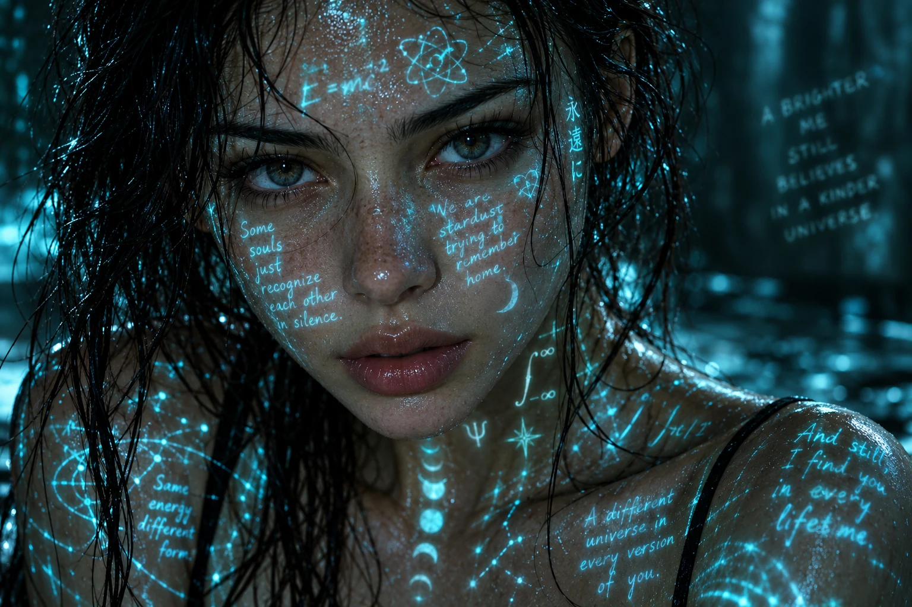

## Пост

Атмосферный фотореалистичный крупный портрет: светящиеся бирюзовые фразы, символы и формулы проецируются на влажную кожу лица, шеи и плеч. Тёмный фон, прямой взгляд и эстетика киберпоэзии.

## Назначение

Создание художественного портрета, сочетающего кинематографическую фотографию, киберпанк и световую проекцию текста на кожу.

## Инструкция

Скопировать оригинал или полный русский перевод в генератор изображений. Исходный промпт самодостаточен: описывает молодую женщину и не требует референса. Формат кадра и конкретный текст фраз не заданы.

Для портрета конкретного человека дополнительно загрузить его фото и отдельно указать требование сохранить внешность: такого требования в оригинале нет. Демонстрационный семпл создан без референса и изображает вымышленную модель.

## Промпт — оригинал

```text
A cinematic, ultra-realistic close-up portrait of a young woman with wet, tousled dark hair and luminous skin, staring directly into the camera with an intense, introspective expression. Glowing cyan handwritten text and symbols are projected across her face, neck, and shoulders, resembling poetic phrases, equations, and abstract handwriting. The light reflections shimmer on her damp skin, creating a futuristic, cyber-poetry aesthetic. Dark, moody background with soft shadows, shallow depth of field, sharp focus on the eyes, high contrast lighting, teal and blue color palette, hyper-detailed skin texture, photorealistic, dramatic atmosphere, cyberpunk meets fine-art portrait photography, 8K quality, cinematic lighting.
```

## Промпт — перевод на русский

```text
Кинематографичный, ультрареалистичный портрет молодой женщины крупным планом: мокрые, растрёпанные тёмные волосы и сияющая кожа; она смотрит прямо в камеру с напряжённым, погружённым в себя выражением лица. Светящиеся бирюзовые рукописные надписи и символы проецируются на её лицо, шею и плечи, напоминая поэтические фразы, уравнения и абстрактные рукописные записи. Отражения света мерцают на её влажной коже, создавая футуристическую эстетику киберпоэзии. Тёмный, мрачный фон с мягкими тенями, малая глубина резкости, резкий фокус на глазах, высококонтрастное освещение, бирюзово-синяя цветовая палитра, сверхдетализированная текстура кожи, фотореализм, драматичная атмосфера, сочетание киберпанка и художественной портретной фотографии, качество 8K, кинематографическое освещение.
```

## Семпл



Создан встроенным image_gen по исходному английскому промпту буквально, без подстановок и референса. Статус: pending, ожидает оценки пользователя. Размер результата: 1536 × 1024 пикселя; сохранён в WebP.

Визуальная проверка: прямой взгляд, мокрые тёмные волосы, фактура влажной кожи, бирюзовые фразы и формулы на лице, шее и плечах присутствуют; фон затемнён. Надписи также попали на фон. Точная корректность всех формул и символов не подтверждена.

## Примечания

- Исходный промпт сохранён полностью и буквально; русский перевод добавлен отдельно.
- Рекламные призывы, декоративные эмодзи и общий хэштег удалены из тела карточки по протоколу viral prompt-posts.
- В исходном посте указан хэштег GPTimage25. Технической зависимости от платформы нет, поэтому поле platform отсутствует.
- Оригинал не задаёт конкретные поэтические фразы, математическую корректность формул или сохранение личности по фото.
- «8K quality» — пожелание исходного промпта, а не подтверждение разрешения полученного файла.
