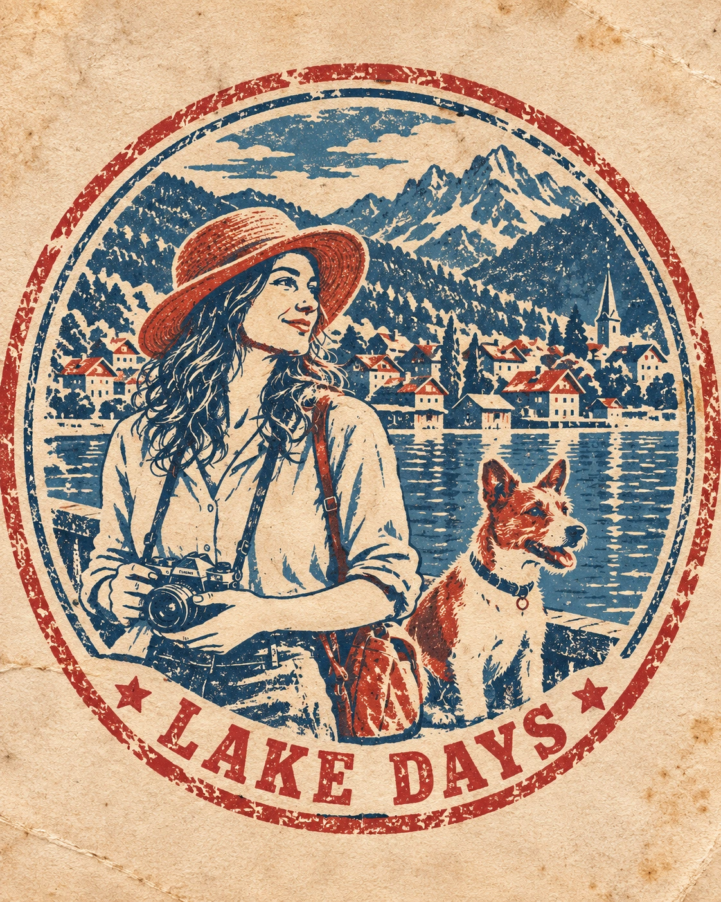

## Пост

Фотография превращается в винтажную туристическую печать: круглая или овальная композиция, рисованный сюжет, 2–3 цвета краски, потёртый оттиск и короткая надпись по дуге.

## Назначение

Создание коллекционного сувенирного изображения для тревел-публикаций и дневников путешествий. Содержание исходной фотографии сохраняется, но полностью перерисовывается крупными графическими формами.

## Инструкция

1. Загрузить фотографию с людьми, животными, предметами или узнаваемой сценой путешествия.
2. Применить исходный промпт. Фотография обязательна; сцена должна быть перерисована, а не вставлена в круг.
3. Проверить узнаваемость сюжета, ограниченную палитру, фактуру старой краски, короткую надпись и вертикальный формат 4:5.
4. Название города, страны и дату использовать только при достоверной идентификации по исходнику; иначе надпись должна описывать занятие, сезон, настроение или момент.

## Промпт — оригинал

```text
PHOTO → RETRO TRAVEL STAMP

Transform the uploaded photo into an authentic VINTAGE TRAVEL STAMP / OLD TOURIST PASSPORT STAMP illustration.

Recreate the CONTENT and STORY of the original photo as if this exact moment had been turned into a collectible travel stamp from the mid-20th century.

100% illustrated stamp.
0% photography.
0% photorealism.
0% smooth digital painting.
0% modern vector perfection.

ORIGINAL PHOTO — CRITICAL

Preserve the most recognizable elements of the uploaded photo:

\- same people and animals
\- recognizable facial characteristics and silhouettes
\- hairstyle
\- pose and interaction
\- clothing and important accessories
\- key objects
\- distinctive landscape, architecture or environment
\- overall mood and story

Simplify everything aggressively into BOLD, GRAPHIC SHAPES suitable for an old printed stamp.

STAMP COMPOSITION — MOST IMPORTANT

Place the entire scene inside a strong CIRCULAR or OVAL stamp composition.

The design should feel like a real vintage tourist souvenir seal or passport-style destination stamp.

Use:

\- thick outer circular/oval border
\- one or two imperfect concentric rings
\- simplified central illustration based on the photo
\- curved typography following the border
\- small decorative separators such as stars, dots, diamonds or short lines

Do NOT simply place the original photo inside a circle.

REDRAW and reinterpret the scene specifically for the stamp format.

VERY LIMITED COLOR PALETTE

Use only 2–3 ink colors for the entire artwork.

Choose a vintage combination appropriate to the original photo, for example:
deep navy + faded red + warm cream,
forest green + rust orange + beige,
burgundy + dusty blue + aged paper.

No gradients.
No realistic colors.
No large variety of shades.

VINTAGE PRINT TEXTURE

Make the stamp look physically printed with old ink.

Include:

\- rough distressed edges
\- uneven ink coverage
\- faded areas
\- tiny missing patches of ink
\- coarse grain
\- imperfect registration
\- worn rubber-stamp texture
\- slightly irregular lines

The print should feel aged and imperfect, NOT digitally clean.

SIMPLIFICATION

Reduce faces, clothing, buildings, landscapes and objects to LARGE recognizable shapes.

Avoid tiny details.

Use bold silhouettes, chunky shadows and simplified linework.

The image should remain understandable even when viewed very small.

TYPOGRAPHY

Generate a SHORT inscription inspired by the actual content of the uploaded photo.

It may reference:

\- visible location, if clearly identifiable
\- activity
\- season
\- mood
\- journey or moment shown in the photo

Keep it short: approximately 1–4 words.

Do NOT invent a specific city, country, date or factual location that cannot be determined from the photo.

Typography should resemble old travel stamps: condensed uppercase lettering, slightly imperfect and worn.

FINAL LOOK

The result should feel like an authentic OLD TRAVEL STAMP discovered in a vintage passport or travel journal — bold, simple, nostalgic, slightly faded and visibly handmade.

Vertical 4:5 Instagram format.
Center the stamp prominently with comfortable negative space around it.
```

## Промпт — перевод на русский

```text
ФОТО → РЕТРО-ТУРИСТИЧЕСКАЯ ПЕЧАТЬ

Преобразуй загруженную фотографию в иллюстрацию в виде аутентичной ВИНТАЖНОЙ ТУРИСТИЧЕСКОЙ ПЕЧАТИ / СТАРОГО ТУРИСТИЧЕСКОГО ШТАМПА В ПАСПОРТЕ.

Воссоздай СОДЕРЖАНИЕ и ИСТОРИЮ исходной фотографии так, словно именно этот момент превратили в коллекционную туристическую печать середины XX века.

100% рисованная печать.
0% фотографии.
0% фотореализма.
0% гладкой цифровой живописи.
0% современной векторной безупречности.

ИСХОДНАЯ ФОТОГРАФИЯ — КРИТИЧЕСКИ ВАЖНО

Сохрани самые узнаваемые элементы загруженной фотографии:

- тех же людей и животных
- узнаваемые черты лица и силуэты
- причёску
- позу и взаимодействие
- одежду и важные аксессуары
- ключевые предметы
- характерный пейзаж, архитектуру или окружение
- общее настроение и историю

Сильно упрости всё до СМЕЛЫХ ГРАФИЧЕСКИХ ФОРМ, подходящих для старой печатной печати.

КОМПОЗИЦИЯ ПЕЧАТИ — САМОЕ ВАЖНОЕ

Размести всю сцену внутри выразительной КРУГЛОЙ или ОВАЛЬНОЙ композиции печати.

Дизайн должен восприниматься как настоящая винтажная туристическая сувенирная печать или штамп места назначения в паспортном стиле.

Используй:

- толстый внешний круглый/овальный контур
- одно или два несовершенных концентрических кольца
- упрощённую центральную иллюстрацию по фотографии
- текст по дуге вдоль контура
- небольшие декоративные разделители: звёзды, точки, ромбы или короткие линии

НЕ помещай исходную фотографию просто внутрь круга.

ПЕРЕРИСУЙ и переосмысли сцену специально для формата печати.

ОЧЕНЬ ОГРАНИЧЕННАЯ ЦВЕТОВАЯ ПАЛИТРА

Используй только 2–3 цвета печатной краски для всей работы.

Выбери винтажное сочетание, подходящее исходной фотографии, например:
тёмно-синий + выцветший красный + тёплый кремовый,
лесной зелёный + ржаво-оранжевый + бежевый,
бордовый + пыльно-голубой + состаренная бумага.

Без градиентов.
Без реалистичных цветов.
Без большого разнообразия оттенков.

ВИНТАЖНАЯ ПЕЧАТНАЯ ФАКТУРА

Сделай так, чтобы печать выглядела физически отпечатанной старой краской.

Добавь:

- грубые потёртые края
- неравномерное покрытие краской
- выцветшие участки
- крошечные пропуски краски
- крупное зерно
- неточное совмещение печатных слоёв
- фактуру изношенного резинового штампа
- слегка неровные линии

Оттиск должен выглядеть состаренным и несовершенным, а НЕ цифровым и чистым.

УПРОЩЕНИЕ

Сведи лица, одежду, здания, пейзажи и предметы к КРУПНЫМ узнаваемым формам.

Избегай мелких деталей.

Используй выразительные силуэты, крупные тени и упрощённые линии.

Изображение должно оставаться понятным даже при очень маленьком размере.

ТИПОГРАФИКА

Создай КОРОТКУЮ надпись, вдохновлённую реальным содержанием загруженной фотографии.

Она может отсылать к:

- видимому месту, если его можно однозначно определить
- занятию
- времени года
- настроению
- путешествию или моменту на фотографии

Сделай её короткой: примерно 1–4 слова.

НЕ выдумывай конкретный город, страну, дату или фактическое место, которые нельзя определить по фотографии.

Типографика должна напоминать старые туристические печати: узкие прописные буквы, слегка несовершенные и потёртые.

ФИНАЛЬНЫЙ ОБЛИК

Результат должен восприниматься как аутентичная СТАРАЯ ТУРИСТИЧЕСКАЯ ПЕЧАТЬ, найденная в винтажном паспорте или дневнике путешествий: выразительная, простая, ностальгическая, слегка выцветшая и заметно выполненная вручную.

Вертикальный формат 4:5 для Instagram.
Размести печать заметно по центру, оставив вокруг достаточно свободного пространства.
```

## Примечания

- Это художественная туристическая печать, а не подлинный документальный штамп.
- Промпт универсален; технической привязки к платформе нет.
- Исходный английский промпт сохранён полностью. Русский перевод не заменяет оригинал.
- Источник указан по ссылке в присланном посте; авторство не установлено. Призыв делиться результатами и рекламная обвязка удалены.
- Результат нужно проверять на читаемость надписи и сохранение узнаваемых черт при сильном упрощении.

## Образец S01



Демонстрационный исходник создан отдельно: путешественница с камерой и собакой у озера на фоне гор и условного поселения. Это синтетический референс, не подтверждённая фотография конкретного места. Семпл создан встроенным imagegen по полному исходному промпту. Надпись LAKE DAYS описывает сюжет и не приписывает ему выдуманную географию.

Визуально проверены рисованная сцена, овальная композиция, две краски на фоне состаренной бумаги, потёртый оттиск, читаемая короткая надпись и вертикальный формат 4:5. Оценка пользователем ожидается: sample_status pending.

[Исходный референс R01](../../../03_SAMPLES/AR-20261005-002/R01.webp)
