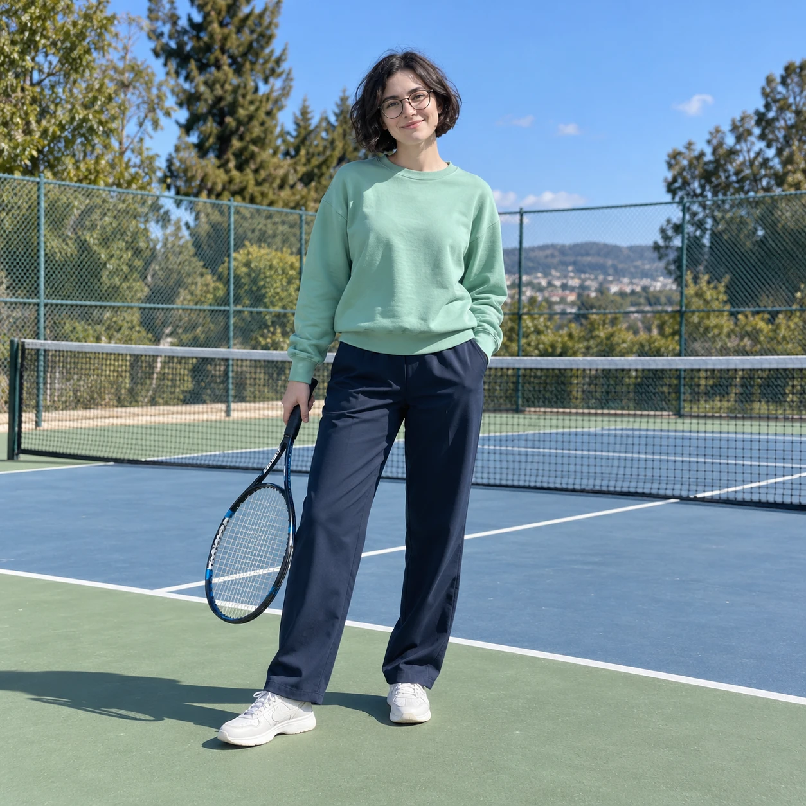
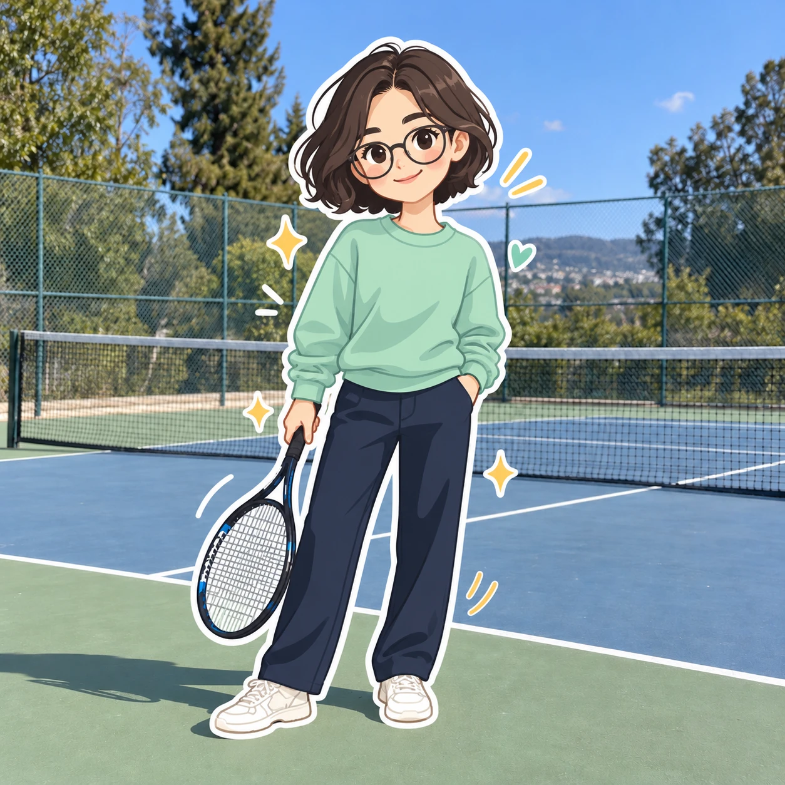

## Пост
Ваше фото превращается в уютную иллюстрацию с эффектом большого стикера: главный человек становится цветным мультяшным персонажем, а фотографический фон сохраняется.

## Назначение
Стилизация одного человека в плоский 2D-персонаж с толстой белой обводкой на исходной фотографии.

## Инструкция
1. Загрузите исходную фотографию с главным человеком.
2. Примените исходный промпт целиком.
3. Проверьте сохранение причёски, очков, одежды, цветов, позы и реквизита.
4. Проверьте, что в кадре один мультяшный персонаж и фотографический фон; окружение не должно быть перерисовано.
Формат кадра в оригинале не задан. Для демонстрации выбран квадратный исходник.

## Промпт — оригинал
```text
Transform only the main human subject in the uploaded image into a full cartoon illustration, while keeping the original background completely unchanged.
MAIN GOAL Remove the realistic human subject entirely and replace them with a cartoon version of the same person. Do not transform, redraw, simplify, stylize, or replace the background. Keep the original photographic background intact, including the environment, perspective, lighting, objects, and overall scene.
SUBJECT TRANSFORMATION Create a cute full-body cartoon character based on the uploaded subject, while preserving:
recognizable hairstyle
glasses or visible accessories
general facial identity
outfit design
main clothing colors
pose and gesture
any important prop or object being used
The final result must contain no realistic human figure. Only the subject is replaced by the cartoon version.
CHARACTER STYLE Use a playful flat 2D cartoon style with:
oversized rounded head
simplified small body
rounded hands and feet
soft organic shapes
clean minimal facial features
simple oval or dot eyes
tiny or minimal nose
small smiling mouth
rosy cheeks
cheerful and friendly expression
VISUAL STYLE Use a clean modern illustration style:
flat colors
minimal shading
soft pastel-like tones
smooth simplified shape construction
simple darker color blocks for depth
no realistic textures
no 3D rendering
no glossy CGI
no anime style
no rough sketch style
OUTLINE Add a thick white sticker-like outline around the cartoon subject so it looks like a large cutout illustration placed into the real photo.
COMPOSITION Show one large cartoon version of the subject in the same approximate position as the original person. Keep the composition natural and visually integrated with the original photo.
BACKGROUND RULE The background must remain original and photorealistic. Do not convert the background into illustration. Do not simplify the court, fence, sky, buildings, or surrounding objects. Do not repaint or stylize the environment. Only replace the human subject.
DECORATIVE ELEMENTS Add a few playful decorative graphic accents around the cartoon subject only, such as:
sparkles
splash shapes
curved doodle marks
floating blobs
simple motion accents
These accents should be light and fun, without covering or changing the original background too much.
FINAL LOOK The final image should look like:
a real photo background
with the original person replaced by a cute cartoon character
clean and cheerful
youthful and modern
visually striking
social-media friendly
commercial illustration quality
Avoid: transforming the background, stylizing the environment, turning the whole image into a cartoon, photorealistic human figure, duplicated subject, extra characters, clutter, text, watermark, logo.
```

## Промпт — перевод на русский
```text
Преобразуй только главного человека на загруженном изображении в полностью рисованную мультяшную иллюстрацию, оставив исходный фон совершенно неизменным.
ГЛАВНАЯ ЦЕЛЬ Полностью убери реалистичного человека и замени его мультяшной версией того же человека. Не преобразовывай, не перерисовывай, не упрощай, не стилизуй и не заменяй фон. Сохрани исходный фотографический фон нетронутым, включая окружение, перспективу, освещение, предметы и сцену в целом.
ПРЕОБРАЗОВАНИЕ ПЕРСОНАЖА Создай милого мультяшного персонажа в полный рост на основе человека с загруженного изображения, сохранив:
узнаваемую причёску
очки или видимые аксессуары
общую узнаваемость лица
дизайн одежды
основные цвета одежды
позу и жест
любой важный реквизит или используемый предмет
В итоговом изображении не должно остаться реалистичной человеческой фигуры. Только человек заменяется своей мультяшной версией.
СТИЛЬ ПЕРСОНАЖА Используй игривый плоский мультяшный 2D-стиль:
увеличенная округлая голова
упрощённое маленькое тело
округлые кисти рук и ступни
мягкие органичные формы
аккуратные минималистичные черты лица
простые глаза в виде овалов или точек
крошечный или минимально обозначенный нос
маленький улыбающийся рот
румяные щёки
весёлое и дружелюбное выражение
ВИЗУАЛЬНЫЙ СТИЛЬ Используй чистый современный иллюстративный стиль:
плоские цвета
минимальные тени
мягкие пастельные оттенки
плавное построение упрощённых форм
простые более тёмные цветовые блоки для глубины
без реалистичных текстур
без 3D-рендеринга
без глянцевой компьютерной графики
без стиля аниме
без грубого эскизного стиля
ОБВОДКА Добавь толстую белую обводку, похожую на контур стикера, вокруг мультяшного персонажа, чтобы он выглядел как большая вырезанная иллюстрация, помещённая в реальную фотографию.
КОМПОЗИЦИЯ Покажи одну крупную мультяшную версию человека примерно в том же месте, где находился исходный человек. Сохрани естественную композицию и визуальную связь с исходной фотографией.
ПРАВИЛО ФОНА Фон должен оставаться исходным и фотореалистичным. Не превращай фон в иллюстрацию. Не упрощай корт, ограду, небо, здания или окружающие предметы. Не перерисовывай и не стилизуй окружение. Замени только человека.
ДЕКОРАТИВНЫЕ ЭЛЕМЕНТЫ Добавь несколько игривых декоративных графических акцентов только вокруг мультяшного персонажа, например:
искры
формы брызг
изогнутые рисованные штрихи
парящие пятна
простые акценты движения
Эти акценты должны быть лёгкими и весёлыми, не перекрывая и не меняя исходный фон слишком сильно.
ИТОГОВЫЙ ВИД Итоговое изображение должно выглядеть так:
фон настоящей фотографии
исходный человек заменён милым мультяшным персонажем
чистое и жизнерадостное
молодёжное и современное
визуально эффектное
подходящее для социальных сетей
качество коммерческой иллюстрации
Избегай: преобразования фона, стилизации окружения, превращения всего изображения в мультфильм, фотореалистичной человеческой фигуры, дублирования персонажа, дополнительных персонажей, перегруженности, текста, водяных знаков, логотипа.
```

## Примечания
- Исходный промпт сохранён буквально и полностью.
- В исходном посте указан #nanobanana; это рекомендация сервиса, технической зависимости в промпте нет.
- Источник: материал пользователя. Упомянуты @creatory и @aicreator; авторство не установлено, ссылка на конкретную публикацию не предоставлена.
- Социальные призывы, реакции и декоративные эмодзи исключены из карточки.
- Связана с AR-20260902-002, но отличается цветным плоским стилем, одним главным персонажем и увеличенной округлой головой.
- Демонстрационный исходник создан искусственно: вымышленная взрослая женщина в очках, с короткими тёмными волосами, мятным свитшотом, тёмными брюками и теннисной ракеткой на корте. Это не фотография пользователя.
- Визуальная проверка: фотографическое окружение сохранено визуально; персонаж, одежда и реквизит стилизованы. Глаза получились подробнее заданных точек/овалов; это ограничение демонстрационного результата. Побайтовая идентичность фона не утверждается.
- Семпл создан встроенным генератором изображений по исходному промпту без изменений. Статус pending до оценки пользователя.

## Семпл
Демонстрационный исходник:


Результат:

