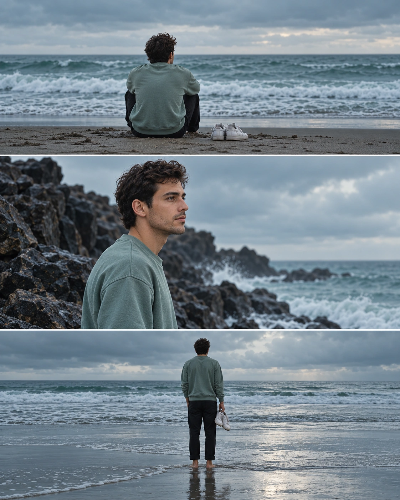

## Пост

Портрет превращается в кинематографическую историю из трёх кадров на пасмурном морском побережье: человек сидит перед океаном, стоит у скал в профиль и встречает прибой с кроссовками в руке.

## Назначение

Создание вертикального фотореалистичного триптиха 4:5 с единым персонажем, одеждой и холодной сине-зелёной цветокоррекцией.

## Инструкция

1. Загрузить чёткое фото человека, желательно с хорошо различимыми чертами лица.
2. Передать модели полный исходный промпт и использовать загруженное фото как референс внешности.
3. Проверить три кадра в правильном порядке, сохранение внешности в среднем кадре, свитшот цвета морской пены, чёрные брюки и белые кроссовки.
4. Формат 4:5 относится к целому коллажу, а не к каждой его панели.

## Промпт — оригинал

```text
A cinematic three-frame vertical film strip collage featuring a young person wearing a seafoam green sweatshirt and black trousers at a gloomy, overcast beach. Top frame: A wide shot of the person sitting on the sand with his back to the camera, looking at the ocean with a pair of white sneakers placed beside him. Middle frame: A medium side profile shot of the person standing near dark, jagged rocks, gazing pensively toward the horizon Bottom frame: A wide shot of the person standing at the water's edge with his back to the camera, holding his white sneakers in one hand. The overall aesthetic is moody and contemplative, featuring a cool teal color grade, soft natural lighting, " 100% my face same, I need this prompt picture, photo in clear. Aspect ratio 4:5
```

## Промпт — перевод на русский

```text
Кинематографический коллаж в виде вертикальной плёночной полосы из трёх кадров: молодой человек в свитшоте цвета морской пены и чёрных брюках на мрачном пасмурном пляже. Верхний кадр: общий план человека, сидящего на песке спиной к камере и смотрящего на океан; рядом с ним стоит пара белых кроссовок. Средний кадр: средний план человека в профиль сбоку, стоящего возле тёмных острых скал и задумчиво смотрящего к горизонту. Нижний кадр: общий план человека, стоящего у кромки воды спиной к камере и держащего белые кроссовки в одной руке. Общая эстетика — мрачная и созерцательная, с холодной сине-зелёной цветокоррекцией и мягким естественным освещением, " моё лицо на 100% такое же, мне нужно изображение по этому промпту, фотография чёткая. Соотношение сторон 4:5
```

## Примечания

- Оригинал сохранён буквально, включая незакрытую кавычку, отсутствие точки после horizon и разговорную фразу о сохранении лица.
- Требование «100% my face same» отражает намерение источника; абсолютное совпадение генератором не гарантируется, внешность нужно проверять.
- Название «Шторм» дано в присланном посте; сам промпт описывает мрачный пасмурный берег без отдельного требования молний или сильной бури.
- Промпт универсален. Хештег GPTimage25 не является технической привязкой к модели.
- Указание creatory взято из подписи присланного поста; конкретная публикация и авторство не установлены. Социальная обвязка исключена.

## Образец S01



Семпл создан встроенным imagegen по исходному промпту на основе отдельно сгенерированного портрета вымышленного взрослого человека. Это демонстрационный исходник, не фотография пользователя. Проверены три панели, последовательность поз, согласованность одежды, присутствие белых кроссовок и формат 4:5. Статус pending — до оценки пользователем.

[Демонстрационный референс R01](../../../03_SAMPLES/AR-20261005-006/R01.webp)
