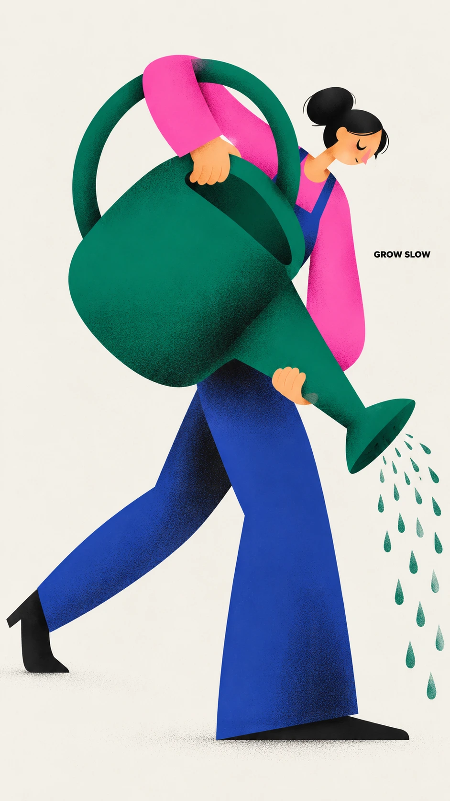

# Креативная иллюстрация персонажа — садовница с огромной лейкой

## Пост
Геометрический постер с садовницей и огромной изумрудной лейкой. Маленькая голова, вытянутые конечности и асимметричный силуэт передают усилие и тихий юмор; подпись «GROW SLOW» остаётся второстепенной.

## Назначение
Создание законченной редакционной иллюстрации персонажа в вертикальном формате 9:16.

## Инструкция
Передайте генератору изображений полный оригинальный промпт. Загруженное фото не требуется; переменных для подстановки нет. Сохраните заданную палитру, один персонаж, одну лейку и точную подпись «GROW SLOW».

## Промпт — оригинал
```text
Create a finished editorial character poster, 9:16, edge-to-edge warm off-white paper. Flat geometric illustration, exaggerated asymmetric proportions, soft airbrushed shading, fine print grain.

One adult female gardener is shown leaning forward while carrying an oversized emerald watering can that is almost as large as her torso. Build the character from a few oversized, asymmetric geometric shapes: small head, long capsule limbs, broad simplified torso, elongated arms, and simple mitten-like hands.

The watering can is deliberately oversized and becomes an essential part of the pose, dramatically changing the overall silhouette. Its large rounded body, long spout, and oversized curved handle should be simplified into a few bold geometric shapes. Avoid realistic object construction; treat it as a strong graphic mass integrated into the character.

Black cut-paper facial features: crescent-shaped eyes, tiny minimal mouth, simple angular nose if needed. No detailed facial rendering. The emotion should read primarily through the whole-body gesture.

Palette:

\- off-white #F3F1EB
\- near-black #10100F
\- hot pink #F553D2
\- warm red #F42726
\- cobalt #293EA1
\- emerald #13785D

Use flat color blocks with crisp edges. Add soft dark-to-color spray gradients only where major shapes overlap, especially around the arms, torso, watering can, and legs. Fine stipple grain should sit mostly inside the colored ink areas and remain barely visible on the off-white paper.

Character & Object:\\
An adult female gardener + one enormous emerald watering can.

Gesture & Emotion:\\
The gardener bends slightly forward while gripping the huge watering can with both hands, as though carefully pouring something much heavier than expected. One long leg is planted firmly while the other stretches backward for balance. The body language should communicate concentration, tenderness, mild physical effort, and quiet humor.

Shape Idea:\\
The oversized rounded watering can forms the dominant horizontal mass across the middle of the composition. Its long spout extends diagonally outward in one direction while the character’s elongated leg extends in the opposite direction, creating a stretched asymmetric silhouette. The large curved handle frames part of the small head and upper torso. The tiny head should feel intentionally disproportionate against the huge object and long limbs.

Place one short caption in small bold black uppercase sans-serif inside an open pocket of empty off-white paper. It must feel secondary to the illustration, not like a headline.

Caption:\\
"GROW SLOW"

No extra text, no logos, no outlined cartoon look, no glossy 3D, no photorealism, no realistic skin rendering, no detailed gardening equipment, no coarse canvas texture, no busy background, no decorative scenery, no extra limbs, no extra objects.
```

## Промпт — перевод на русский
```text
Создай законченный редакционный постер с персонажем, 9:16, на тёплой бумаге оттенка off-white, заполняющей холст до краёв. Плоская геометрическая иллюстрация, преувеличенные асимметричные пропорции, мягкие аэрографические тени, мелкое печатное зерно.

Одна взрослая женщина-садовница показана наклонившейся вперёд и несущей огромную изумрудную лейку почти размером с её торс. Собери персонажа из нескольких крупных асимметричных геометрических форм: маленькая голова, длинные конечности в форме капсул, широкий упрощённый торс, вытянутые руки и простые кисти, похожие на варежки.

Лейка намеренно увеличена и становится неотъемлемой частью позы, резко меняя общий силуэт. Её большой округлый корпус, длинный носик и огромную изогнутую ручку следует упростить до нескольких выразительных геометрических форм. Избегай реалистичной конструкции предмета; трактуй его как мощную графическую массу, интегрированную в персонажа.

Черты лица словно вырезаны из чёрной бумаги: глаза в форме полумесяцев, крошечный минималистичный рот, при необходимости простой угловатый нос. Никакой детальной прорисовки лица. Эмоция должна считываться прежде всего через жест всего тела.

Палитра:

\- off-white #F3F1EB
\- почти чёрный #10100F
\- ярко-розовый #F553D2
\- тёплый красный #F42726
\- кобальтовый #293EA1
\- изумрудный #13785D

Используй плоские цветовые блоки с чёткими краями. Добавляй мягкие напылённые градиенты от тёмного к цветному только в местах перекрытия крупных форм, особенно вокруг рук, торса, лейки и ног. Мелкое точечное зерно должно находиться главным образом внутри участков цветной краски и оставаться едва заметным на бумаге off-white.

Персонаж и предмет:\\
Взрослая женщина-садовница + одна огромная изумрудная лейка.

Жест и эмоция:\\
Садовница слегка наклоняется вперёд, держась обеими руками за огромную лейку, словно осторожно выливает что-то гораздо более тяжёлое, чем ожидала. Одна длинная нога прочно стоит на земле, а другая вытянута назад для равновесия. Язык тела должен передавать сосредоточенность, нежность, лёгкое физическое усилие и тихий юмор.

Идея формы:\\
Огромная округлая лейка образует доминирующую горизонтальную массу в середине композиции. Её длинный носик выступает по диагонали в одну сторону, а вытянутая нога персонажа — в противоположную, создавая растянутый асимметричный силуэт. Большая изогнутая ручка обрамляет часть маленькой головы и верхнего торса. Крошечная голова должна выглядеть намеренно непропорциональной по отношению к огромному предмету и длинным конечностям.

Размести одну короткую подпись мелким жирным чёрным шрифтом без засечек, прописными буквами, в свободном участке пустой бумаги off-white. Она должна ощущаться второстепенной по отношению к иллюстрации, а не заголовком.

Подпись:\\
"GROW SLOW"

Никакого дополнительного текста, логотипов, контурного мультяшного рисунка, глянцевого 3D, фотореализма, реалистичной прорисовки кожи, детализированного садового оборудования, грубой текстуры холста, перегруженного фона, декоративного окружения, лишних конечностей, лишних предметов.
```

## Примечания
- Источник: [dailyprompts.ru](https://dailyprompts.ru/), ссылка предоставлена пользователем; конкретная публикация и автор не указаны.
- Оригинал сохранён буквально, включая обратные слеши исходного сообщения.
- Универсальный промпт без технической зависимости от конкретной платформы.
- Призыв делиться результатами и ссылка на чат исключены как социальная обвязка.
- Демонстрационный семпл создан по исходному оригиналу без подстановок. Проверка агентом не заменяет оценку пользователя; статус семпла — pending.

## Семпл

