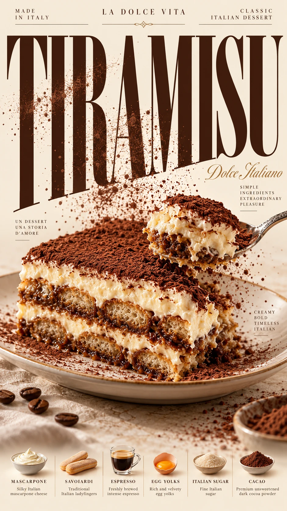

## Пост

Вертикальный постер итальянского тирамису с крупной типографикой Bodoni, тёплой палитрой, ложкой с кусочком десерта и осыпающимся какао.

## Назначение

Создание редакционных и рекламных визуалов для кондитерских, кафе и гастрономических публикаций.

## Инструкция

Скопировать оригинал или полный русский перевод в генератор изображений. Использовать вертикальный формат 9:16. Обязательных референсов и переменных нет: блюдо, палитра и надписи заданы в тексте. Проверить читаемость TIRAMISU, слои десерта, геометрию ложки и перекрытия букв перед публикацией.

## Промпт — оригинал

```text
Create a premium 9:16 Food × Typography editorial poster.
Food: Authentic Italian Tiramisu — an exquisite rectangular slice of traditional tiramisu with perfectly defined alternating layers of espresso-soaked savoiardi biscuits and airy mascarpone cream, generously dusted with fine dark cocoa powder. Luxurious, velvety, and irresistibly creamy.
Headline: TIRAMISU — enormous, elegant, high-contrast Bodoni-style serif typography in rich espresso brown, dominating the vertical composition.
Colors: Warm ivory (#F7F0E5), deep espresso brown (#38251C), dark cocoa (#644331), creamy mascarpone (#FFF1D8), soft caramel (#C58A59), and muted champagne gold (#D8BC8E).
Ingredients: Silky Italian mascarpone cheese, espresso-soaked savoiardi ladyfingers, freshly brewed intense espresso, rich egg yolks, fine Italian sugar, and premium unsweetened dark cocoa powder.
Combine photorealistic commercial food photography with enormous Didone/Bodoni-style serif typography.
Make the tiramisu slice elegantly overlap the giant letters of "TIRAMISU", alternating naturally between foreground and background to create convincing 3D depth. Position the layered dessert diagonally across the typography, allowing the creamy mascarpone edges to visually interact with selected letterforms. A delicate silver dessert spoon cuts into the upper cream layer, lifting a small realistic bite. Fine cocoa powder gently falls across the composition, with some particles passing in front of the giant letters and others disappearing behind them.
Use hyperrealistic mascarpone textures, delicate porous sponge layers, moist espresso-soaked biscuit details, soft cocoa powder particles, subtle creamy highlights, and elegant warm studio lighting.
Add refined magazine-style typography, an italic "Dolce Italiano" subtitle, meaningful ingredient descriptions such as "Mascarpone · Espresso · Savoiardi · Cacao", small editorial labels including "MADE IN ITALY", "LA DOLCE VITA", and "CLASSIC ITALIAN DESSERT", and carefully balanced negative space.
Warm ivory background, bold visual hierarchy, rich but controlled colors, premium Italian patisserie advertising aesthetic.
Keep the TIRAMISU headline readable and the dessert physically realistic.
Ultra-detailed, sophisticated, print-ready, vertical 9:16.
No watermarks, random logos, meaningless text, artificial cream textures, impossible floating dessert layers, or cartoonish rendering.
```

## Промпт — перевод на русский

```text
Создай премиальный редакционный постер 9:16, сочетающий еду и типографику.
Еда: аутентичный итальянский тирамису — изысканный прямоугольный кусок традиционного тирамису с идеально различимыми чередующимися слоями печенья савоярди, пропитанного эспрессо, и воздушного крема маскарпоне, щедро посыпанный мелким тёмным какао-порошком. Роскошный, бархатистый и неотразимо сливочный.
Заголовок: TIRAMISU — огромная, элегантная, высококонтрастная антиква в стиле Bodoni насыщенного коричневого цвета эспрессо, доминирующая в вертикальной композиции.
Цвета: тёплая слоновая кость (#F7F0E5), глубокий коричневый эспрессо (#38251C), тёмное какао (#644331), сливочный маскарпоне (#FFF1D8), мягкая карамель (#C58A59) и приглушённое золото шампанского (#D8BC8E).
Ингредиенты: шелковистый итальянский сыр маскарпоне, печенье савоярди, пропитанное эспрессо, свежесваренный насыщенный эспрессо, густые яичные желтки, мелкий итальянский сахар и высококачественный несладкий тёмный какао-порошок.
Сочетай фотореалистичную коммерческую фуд-фотографию с огромной антиквой в стиле Didone/Bodoni.
Пусть кусок тирамису элегантно перекрывает гигантские буквы слова "TIRAMISU", естественно чередуя положение перед ними и за ними для убедительной трёхмерной глубины. Расположи многослойный десерт по диагонали относительно типографики так, чтобы сливочные края маскарпоне визуально взаимодействовали с отдельными буквами. Изящная серебряная десертная ложка врезается в верхний слой крема и приподнимает небольшой реалистичный кусочек. Мелкий какао-порошок мягко осыпается по композиции: часть частиц проходит перед гигантскими буквами, а другие исчезают за ними.
Используй гиперреалистичные текстуры маскарпоне, нежные пористые слои бисквита, детали влажного печенья, пропитанного эспрессо, мягкие частицы какао-порошка, деликатные сливочные блики и элегантное тёплое студийное освещение.
Добавь изысканную журнальную типографику, курсивный подзаголовок "Dolce Italiano", содержательные описания ингредиентов, например "Mascarpone · Espresso · Savoiardi · Cacao", небольшие редакционные надписи, включая "MADE IN ITALY", "LA DOLCE VITA" и "CLASSIC ITALIAN DESSERT", а также тщательно сбалансированное свободное пространство.
Тёплый фон цвета слоновой кости, выразительная визуальная иерархия, насыщенные, но сдержанные цвета, эстетика премиальной рекламы итальянской кондитерской.
Сохрани читаемость заголовка TIRAMISU и физическую реалистичность десерта.
Сверхдетализированное, изысканное изображение, готовое к печати, вертикальный формат 9:16.
Без водяных знаков, случайных логотипов, бессмысленного текста, искусственных текстур крема, невозможных парящих слоёв десерта и мультяшной визуализации.
```

## Семпл



Сгенерирован встроенным image_gen по исходному английскому промпту без подстановок. Статус: pending, ожидает оценки пользователя.

## Примечания

- Исходный промпт сохранён буквально; социальный призыв отделён от полезного содержимого. Авторство не установлено: указан предоставленный источник.
- Платформа технически не задана, поэтому поле platform отсутствует.
- Связанная карточка AR-20260912-002 содержит универсальный шаблон взаимодействия еды и букв; здесь самостоятельный конкретный промпт тирамису с собственной палитрой, ингредиентами и действием ложки.
- В семпле заголовок читаем, десерт и ложка правдоподобны. Чередование десерта перед буквами и за ними выражено слабее задания; точная строка ингредиентов передана отдельными подписями. Полное соответствие всем композиционным требованиям не подтверждено.
- «Print-ready» в исходнике — пожелание: разрешение, цветовой профиль и вылеты необходимо проверить отдельно перед печатью.
